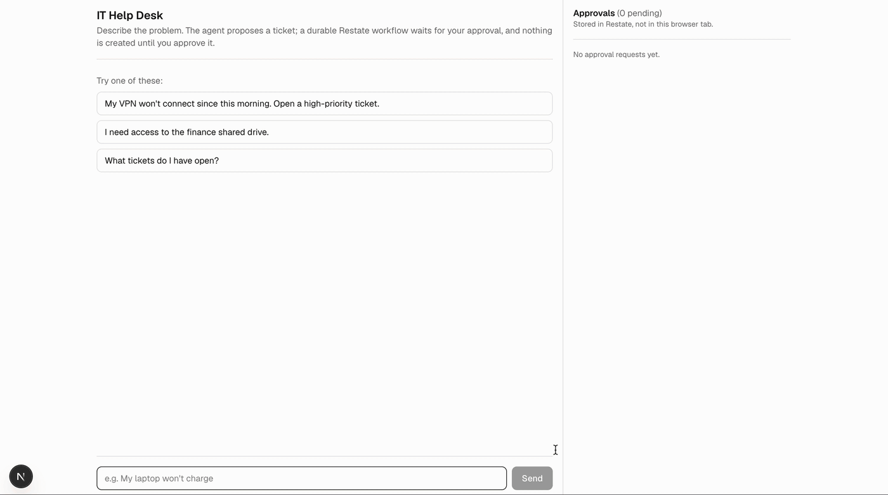
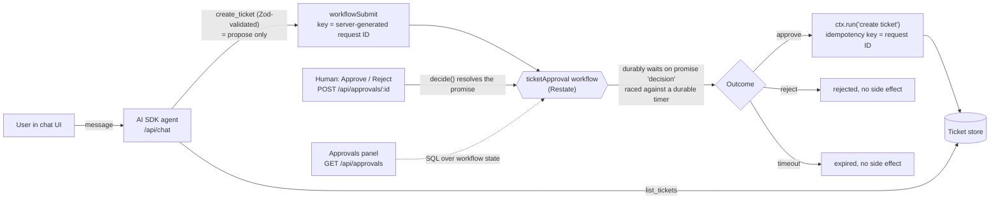

# Helpdesk Durable Approvals

An AI help desk agent whose ticket approvals run as [Restate](https://restate.dev) durable workflows. A pending approval survives server restarts and expires safely after a timeout, and a ticket is never created twice, even if Approve is clicked twice or the process crashes in the middle of creating it.



*The crash-and-resume demo, at 1.5× speed. The agent proposes a ticket, and the approval waits in a Restate workflow. The Restate server, the service and the Next.js app are then killed with `kill -9`. The chat is gone after the restart because it lived in the browser, but the approval is still pending in the panel, with its original deadline. The log shows Restate replaying the workflow on the new process. Approve creates IT-1042.*

## Why durable approvals matter for agents

An agent that can act should propose an action and wait for a human to approve it. If the browser or the chat request holds that wait, it is fragile: a page refresh, a server deploy or a crash loses the pending action, and a long wait (a manager who answers tomorrow) can't fit inside one HTTP request. The approval has to live somewhere that survives all of these. It also needs a deadline and must never run the action twice. This project moves the approval step of a [Next.js + AI SDK help desk agent](https://github.com/walidelkhatib/helpdesk-approval-agent) out of the browser and into a Restate workflow.

## How it works



1. The user describes a problem. The agent calls `create_ticket`. The AI SDK validates the arguments with Zod.
2. `create_ticket` does **not** create anything. It generates a request ID on the server and submits a `ticketApproval` workflow with that key ([`src/lib/approvals.ts`](src/lib/approvals.ts)), then returns `pending_approval` to the model.
3. The workflow ([`src/restate/ticket-approval.ts`](src/restate/ticket-approval.ts)) validates the ticket again, stores an `approval` record in its state and **durably waits** on its `decision` promise, with a 2-minute timeout.
4. Approve and Reject call `POST /api/approvals/:id`. That route calls the workflow's `decide` handler, which resolves the promise.
5. On approve, the workflow creates the ticket inside `ctx.run`, using the request ID as the idempotency key. On reject or timeout it records the outcome and ends with no side effect.
6. The approvals panel polls `GET /api/approvals`. That route reads every workflow's `approval` state from Restate's SQL introspection API, so the list survives a page refresh or a server restart.

The model can only propose. The workflow is the only code path that calls `createTicket`.

## The three demos


*All three outcomes in the panel: a pending request, an expired one (no decision within the timeout, so no ticket) and one approved after a full restart.*

Each demo has an automated test, and you can also reproduce it by hand. Run all the tests with `npm test`; it needs no API key and no running servers. The durable tests start their own Restate server and service on separate ports, then kill and restart them.

```text
✔ 1a. crash and resume: kill the service AND Restate while waiting, restart, approve → one ticket
✔ 1b. crash mid-step: the process dies right after writing the ticket → still one ticket
✔ 2. double approval: three concurrent Approves, a late Approve and a resubmit → one ticket
✔ 3. timeout: nobody answers (and the service is down meanwhile) → expired, no ticket
```

The manual steps below go through Restate's ingress with `curl`, so they work without a model key. With `AI_GATEWAY_API_KEY` set, you can start from the chat instead: ask for a ticket and use the card's buttons.

First start everything with `npm run dev:all` (see [How to run locally](#how-to-run-locally)) and open http://localhost:3000.

### 1. Crash and resume

```bash
# Propose a ticket (this is what the create_ticket tool does)
curl -s localhost:8080/ticketApproval/demo-1/run/send --json '{
  "ticket": {"category":"network","priority":"high","summary":"VPN will not connect","details":"Times out since 9am."},
  "timeoutSeconds": 120 }'
```

The card appears in the panel as **Waiting for approval**. Now kill everything: press Ctrl+C on `npm run dev:all`, or run `pkill -9 -f restate-server` and the other processes, to make it a real crash. Run `npm run dev:all` again and refresh the page. The card is still pending, and the countdown hasn't reset. Click **Approve**, and the card turns into **Ticket created: IT-1042**. `.data/tickets.json` contains exactly one ticket with `"requestId": "demo-1"`.

To crash *inside* the ticket step, start the service with `FAULT_CRASH_AFTER_TICKET_WRITE=1`. It exits right after writing the ticket, before Restate has recorded that the step finished. Restart it, and Restate retries the step. The idempotency key returns the existing ticket, so there is still exactly one (test 1b).

### 2. Double approval

```bash
curl -s localhost:8080/ticketApproval/demo-2/run/send --json '{
  "ticket": {"category":"hardware","priority":"low","summary":"Laptop battery drains fast","details":"Full to empty in 2 hours."},
  "timeoutSeconds": 120 }'

# Two approvals at the same time, through the app's decision endpoint
for i in 1 2; do curl -s localhost:3000/api/approvals/demo-2 --json '{"approved":true}' & done; wait
# → {"accepted":true,"status":"approved"}{"accepted":false,"status":"pending"}
```

Only one decision is accepted. One ticket exists for `demo-2`. Approving again later returns `{"accepted":false,"status":"created"}`, and resubmitting the workflow returns `PreviouslyAccepted`.

### 3. Timeout

```bash
curl -s localhost:8080/ticketApproval/demo-3/run/send --json '{
  "ticket": {"category":"access","priority":"medium","summary":"Finance shared drive access","details":"Needs read access."},
  "timeoutSeconds": 20 }'
```

Wait 20 seconds. You can stop the service during the wait; the timer lives in Restate. The card shows **Expired: nothing was created** with *No decision within 20s*. A late Approve returns `{"accepted":false,"status":"expired"}`, and no ticket exists for `demo-3`.

You can inspect the workflows with the Restate UI at http://localhost:9070 or with the CLI:

```bash
npx restate sql "select target_service_key, status from sys_invocation where target_service_name = 'ticketApproval'"
```

## Design notes

**Patterns used, and why.**

- **A workflow, not a plain service.** A Restate workflow's `run` handler runs exactly once per key. Keying it by the approval request ID gives deduplication for free: resubmitting the same ID returns `PreviouslyAccepted` instead of starting a second approval. Workflows also come with per-key K/V state, which the UI reads, and shared handlers (`decide`, `status`) that run alongside the waiting `run` handler.
- **A durable promise, not an awakeable or polling.** Restate's agent examples use awakeables, which are addressed by a generated ID that has to be stored and passed around. A workflow promise is addressed by the workflow key plus a name (`decision`), so the decision endpoint needs nothing but the request ID. There is no polling: the workflow suspends while it waits, and Restate re-invokes it when the promise resolves.
- **`orTimeout` on the promise.** `ctx.promise("decision").get().orTimeout(ms)` races the promise against a durable timer. On expiry it throws `TimeoutError`, and the workflow records `expired`. The timer is stored in Restate, so it fires on time even if no service process is running. When the service comes back, the workflow continues from the timeout.
- **The deadline is deterministic.** `ctx.date.now()` is journaled, so the `expiresAt` the UI shows is identical on every replay. The timeout itself comes from the workflow's input, which is journaled too.

**Why the side effect runs exactly once.** Restate journals every step: state writes, the promise, the timer and the `ctx.run` result. After a crash, Restate replays the journal on a fresh process. Steps that already completed return their recorded results instead of running again. That covers every case except a crash *during* `ctx.run`, after the ticket was written but before the result was recorded. For that window, `createTicket` is idempotent on the request ID: the retry finds the existing ticket and returns it. A real ticketing system would get the request ID as its idempotency key or external reference.

**Why two Approves create one ticket.** `decide` first checks the stored status and ignores anything that isn't `pending`. Two concurrent calls can both pass that check, but a durable promise completes only once. The second `resolve` fails, and `decide` reports `accepted: false`. Either way, `run` reads a single decision, so it reaches `ctx.run` at most once.

**What Restate journals here:** the workflow input (ticket and timeout), `ctx.date.now()` results, each `ctx.set("approval", …)`, the `decision` promise and its value, the timeout timer, the `ctx.run("create ticket")` result, and the final output. Shared-handler calls are separate invocations with their own journals.

**Forged approvals.** The original app HMAC-signed approval requests because the browser sent the whole chat history back, including the approval. Here, the browser holds no approval state that could be forged. The request ID is a server-generated UUID, and the only way to resolve the promise from outside is `POST /api/approvals/:id`, a server route that validates the body with Zod and calls `decide`. The model has no tool that approves or creates tickets. The Restate ingress (8080) and admin (9070) ports must not be public. In production, Restate Cloud or request identity keys handle that.

**Retention.** Finished approvals are kept for a day (`workflowRetention: { days: 1 }`), so the panel can show outcomes and a late Approve is still a safe no-op. After that, Restate clears the state.

## Limits and next steps

- **No authentication.** Anyone who can reach the app can approve. Next steps would be sign-in, per-user tickets and role-based approvers.
- **The ticket store is a JSON file** shared by the service and the app. A real version would call ServiceNow or Jira with the request ID as the idempotency key.
- **The panel polls** Restate's SQL API every 1.5 seconds. That's fine for a demo. At scale, an index (a virtual object) or push updates would be better.
- **Only the chat is ephemeral.** The approval card in the chat goes away on refresh, while the panel keeps it.
- **Next steps:** deploy the service to Restate Cloud with a live link; multi-step approvals (manager, then security) as a chain of promises with escalation on timeout; make every agent tool call a durable step with `@restatedev/vercel-ai-middleware`.

## How to run locally

Requirements: Node.js 22 or newer. The Restate server and CLI are installed as npm dev dependencies, so you don't need Docker.

```bash
npm install
cp .env.example .env.local   # add AI_GATEWAY_API_KEY to use the chat; the demos don't need it
npm run dev:all
```

`dev:all` starts four processes:

| Process | Command | Port |
| --- | --- | --- |
| Restate server (data in `.restate/`) | `npm run restate` | 8080 ingress, 9070 admin and UI |
| `ticketApproval` service | `npm run service` | 9080 |
| Register the service with Restate (runs once) | `npm run register` | n/a |
| Next.js app | `npm run dev` | 3000 |

You can also run them in separate terminals in that order, which makes it easy to kill one at a time. Run `npm run register` again after changing the workflow's handlers.

Tests: `npm test` runs everything, and `npm run test:durable` runs only the Restate scenarios.

To reset local state, stop everything and run `rm -rf .restate .data`.
