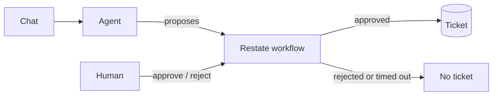
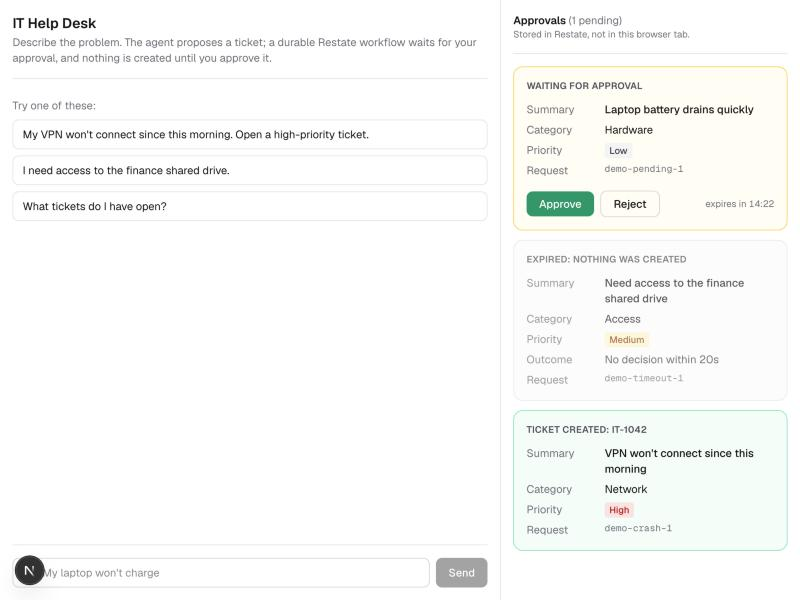

# Helpdesk Durable Approvals

An IT help desk agent where ticket approvals run as [Restate](https://restate.dev) workflows. A pending approval survives a crash, expires if nobody answers, and never creates the same ticket twice.


*The agent proposes a ticket. Then Restate, the service and the Next.js app are killed with `kill -9` and restarted. The chat is gone, but the approval is still waiting with its original deadline. Approving it creates the ticket. Played at 1.5× speed.*

## Why

This started as a [help desk agent](https://github.com/walidelkhatib/helpdesk-approval-agent) where the approval lived in the browser. A refresh, a deploy or a crash lost the pending request, and a long wait didn't fit in one HTTP request. Here the approval lives in a Restate workflow instead.

## How it works



- When the agent calls `create_ticket`, nothing gets created. The server starts a `ticketApproval` workflow, keyed by a request ID it generates, and the agent tells the user the ticket is waiting for approval.
- The workflow waits on a durable promise with a 2-minute timeout ([`ticket-approval.ts`](src/restate/ticket-approval.ts)).
- Approve and Reject call `POST /api/approvals/:id`, which resolves the promise.
- If the ticket is approved, the workflow creates it inside `ctx.run`, using the request ID as an idempotency key. If it's rejected or times out, the workflow records why and stops.
- The approvals panel reads its list from Restate, so it survives a refresh or a restart.

The model can only propose. The workflow is the only code that creates tickets.

## Demos

`npm test` runs all of them against a real Restate server. It doesn't need an API key.

```text
✔ crash and resume: kill the service and Restate while waiting, restart, approve → one ticket
✔ crash mid-step: the process dies right after writing the ticket → still one ticket
✔ double approval: three Approves at once, a late Approve and a resubmit → one ticket
✔ timeout: nobody answers (and the service is down meanwhile) → expired, no ticket
```

To try them by hand, run `npm run dev:all` and open http://localhost:3000. You can ask the chat for a ticket, or skip the model and start an approval with curl:

```bash
curl -s localhost:8080/ticketApproval/demo-1/run/send --json '{
  "ticket": {"category":"network","priority":"high","summary":"VPN will not connect","details":"Times out since 9am."},
  "timeoutSeconds": 120 }'
```

- **Crash and resume.** While the card is pending, run `pkill -9 -f restate-server; pkill -9 -f "src/restate/serve.ts"; pkill -9 -f "next dev"`. Start `npm run dev:all` again and refresh. The card is still pending. Approve it, and one ticket appears in `.data/tickets.json`.
- **Double approval.** Approve twice at the same time with `for i in 1 2; do curl -s localhost:3000/api/approvals/demo-1 --json '{"approved":true}' & done; wait`. One call returns `accepted: true` and the other `accepted: false`.
- **Timeout.** Start one with `"timeoutSeconds": 20` and leave it alone. It expires with no ticket, and approving it afterwards does nothing.



## Design notes

The approval is a workflow rather than a plain service because a workflow runs once per key. Submitting the same request ID twice doesn't start a second approval. Workflows also get their own state, which the UI reads.

The wait uses a workflow promise rather than an awakeable. A workflow promise is addressed by the request ID, so the approve endpoint doesn't need any other ID. The workflow suspends while it waits, and nothing polls.

The timeout is `orTimeout()` on the promise. The timer lives in Restate, so it fires on time even if the service is down.

Restate journals each step. After a crash it replays the journal, and steps that already finished return their recorded results without running again. One gap remains: a crash inside `ctx.run`, after the ticket is written but before Restate has recorded the result. That's why ticket creation is also idempotent on the request ID. The crash mid-step test covers this with a fault flag, `FAULT_CRASH_AFTER_TICKET_WRITE=1`.

A durable promise can only be resolved once, so a second Approve is ignored. Approvals can't be forged from the browser, because it holds no approval state. The request ID is generated on the server, and only the server route can resolve the promise.

## Limits

- There's no login, so anyone who can reach the app can approve.
- Tickets are stored in a JSON file. A real version would call Jira or ServiceNow with the request ID as the idempotency key.
- The panel polls every 1.5 seconds.
- Next steps would be a Restate Cloud deploy, multi-step approvals (manager, then security) and making every agent tool call a durable step.

## Running locally

You'll need Node.js 22 or newer. The Restate server comes with the npm dev dependencies, so you don't need Docker.

```bash
npm install
cp .env.example .env.local   # add AI_GATEWAY_API_KEY to use the chat
npm run dev:all
```

This starts the Restate server (8080, with its UI on 9070), the workflow service (9080) and the Next.js app (3000), and registers the service with Restate. To reset everything, stop it and run `rm -rf .restate .data`.
